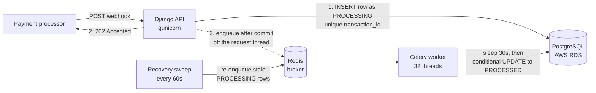

# Transaction Webhook Service

A Django service that receives transaction webhooks from payment processors (such as Razorpay). It acknowledges each one in milliseconds and processes the transaction reliably in the background.

- **Live API:** `http://<to-be-added-after-deploy>`
- **Interactive docs (Swagger):** `/docs/`

## API

| Method | Path | Purpose |
|---|---|---|
| `GET` | `/` | Health check: `{"status": "HEALTHY", "current_time": "2024-01-15T10:30:00Z"}` |
| `POST` | `/v1/webhooks/transactions` | Receive a webhook. Always **`202 Accepted`**, including for duplicates |
| `GET` | `/v1/transactions/{transaction_id}` | Transaction status, returned as a single-item list (matching the spec). `404` if unknown |

```bash
BASE=http://localhost:8000

# Send a webhook -> 202
curl -i -X POST $BASE/v1/webhooks/transactions -H 'Content-Type: application/json' -d '{
  "transaction_id": "txn_abc123def456",
  "source_account": "acc_user_789",
  "destination_account": "acc_merchant_456",
  "amount": 1500,
  "currency": "INR"
}'
# {"message": "Webhook accepted.", "transaction_id": "txn_abc123def456", "duplicate": false}

# Check status: PROCESSING now, PROCESSED (with processed_at) after ~30s
curl $BASE/v1/transactions/txn_abc123def456
# [{"transaction_id": "txn_abc123def456", ..., "amount": 1500.0, "currency": "INR",
#   "status": "PROCESSING", "created_at": "...Z", "processed_at": null}]
```

**Validation.** All fields are required. `amount` must be a positive decimal with at most 2 decimal places. `currency` must be a 3-letter code and is stored uppercased. An invalid body returns `400` and nothing is stored. A replay with the same `transaction_id` returns `202` with `"duplicate": true` and the original record is left untouched.

## Architecture



1. The webhook view validates the body and runs a single `INSERT` (via `get_or_create`) that stores the transaction as `PROCESSING`. The `202` is returned only after this commit, so **every acknowledged transaction is already durable in Postgres**.
2. After the commit, the task is handed to Celery from a small background thread pool. A broker problem therefore can never slow the response. While testing, a stopped Redis made each publish stall for about 7s on DNS lookups; moving the publish off the request thread kept the webhook at about 10ms.
3. The worker simulates the external call (`sleep 30`). It then marks the row `PROCESSED` with a **conditional update** (`WHERE status = 'PROCESSING'`), so a task that is delivered twice cannot process twice.
4. A **recovery sweep** (Celery beat, every 60s) re-enqueues `PROCESSING` rows that haven't been touched for 5 minutes. This catches anything whose message was lost: a worker killed mid-task, Redis down at ingest time, or a process crash before the publish ran.

## How each requirement is met

| Requirement | How |
|---|---|
| 202 within 500ms | The request path is one indexed INSERT plus a commit, and the broker publish happens off-thread. Measured locally: ~30ms for a single webhook, p95 ~140ms with 100 concurrent webhooks, ~10ms with Redis stopped. |
| 30s background processing | Celery task with a configurable delay (`TRANSACTION_PROCESSING_DELAY_SECONDS`). The thread pool (32 threads) runs many sleeps in parallel because the work is I/O-bound. |
| Idempotency | A `UNIQUE` constraint on `transaction_id`. Concurrent duplicates race on the constraint and exactly one wins; this is tested with 8 simultaneous threads. Only the winner enqueues a task. The task's conditional update protects against duplicate deliveries. |
| Persistent storage | PostgreSQL (AWS RDS) stores status, `created_at`, `processed_at` and `updated_at`. |
| No lost transactions | The row is persisted before the ack. Tasks use `acks_late` + `reject_on_worker_lost`, so a crash re-queues the message. Redis keeps an append-only file. The recovery sweep covers every remaining gap. Verified by killing the worker with `SIGKILL` mid-task and by stopping Redis while webhooks were arriving; every transaction ended `PROCESSED`. |

## Technical choices

- **Django + DRF.** Mature, with explicit `APIView` endpoints and serializer validation. The database logic sits in a small service layer (`apps/transactions/services.py`) and the Celery side in `tasks.py`, so the views stay thin.
- **PostgreSQL as the source of truth, Redis as the broker only.** Durability lives in the database, not the queue. Losing Redis loses no data; it only delays processing until the sweep runs.
- **Celery with acks_late and a threads pool.** Celery is a proven task queue with built-in retries and a beat scheduler. The threads pool suits sleep-heavy, I/O-bound work. The DB connection is released during the 30s wait, so long tasks don't use up RDS connections.
- **Idempotency in the database, not in application code.** A unique constraint is the only check that stays correct across multiple web processes and hosts.
- **Single EC2 host + RDS (AWS free tier).** Docker Compose runs web, worker and Redis on one instance. This is the simplest setup that meets the brief; the trade-offs are listed below.

**Trade-offs and what I'd add for production:**
- **Webhook authentication:** verify the processor's HMAC signature (e.g. `X-Razorpay-Signature`) before accepting.
- **Payload conflicts:** a duplicate `transaction_id` with a *different* payload is currently ignored. I'd log or alert on it.
- **Managed queue:** replace Redis with SQS (or ElastiCache) and run web and worker separately, so each can autoscale.
- **Permanent failures:** add a `FAILED` state with a retry limit and a dead-letter queue. The only failure today is a simulated sleep, so retries are effectively unlimited.
- **Operations:** metrics and alerting on queue depth and on the age of rows stuck in `PROCESSING`; HTTPS via CloudFront or an ALB.

## Running locally

Requirements: Docker. For running outside containers you also need [uv](https://docs.astral.sh/uv/).

**Full stack in Docker** (Postgres, Redis, API on `:8000`, worker):
```bash
docker compose up -d --build
curl http://localhost:8000/
```

**Or run Django and Celery with uv** (Postgres on `:5435` and Redis on `:6381` stay in Docker):
```bash
make dev                 # start Postgres + Redis
uv sync
make migrate
make run                 # API on :8000
make worker              # in another terminal: Celery worker + recovery sweep
```

## Testing

**Unit and integration tests** (pytest-django, 26 tests; needs `make dev`):
```bash
make test
```
They cover:
- the health check format
- the 202 response and persisted state
- sequential duplicates and 8-thread concurrent duplicates
- validation errors and malformed JSON
- acknowledging while the broker is down
- the response shape (list, numeric amount, `Z` timestamps)
- task processing, redelivery and failure handling
- the recovery sweep

**End-to-end smoke test** of the assessment's success criteria, against any deployment. It uses only the Python standard library:
```bash
python scripts/smoke_test.py --base-url http://localhost:8000          # or the live URL
python scripts/smoke_test.py --base-url http://localhost:8000 --load 100
```
It checks:
- a single transaction is processed after ~30s
- 7 duplicate deliveries (5 of them concurrent) produce one record
- p95 latency is under 500ms for 50 or more concurrent webhooks while processing is under way
- bad input returns 400 or 404 and the service stays healthy

**Crash-recovery demo** (local Docker; set `TRANSACTION_STALE_AFTER_SECONDS` lower on the worker to see recovery sooner):
```bash
TXN=txn_crash_$RANDOM
curl -X POST localhost:8000/v1/webhooks/transactions -H 'Content-Type: application/json' \
  -d "{\"transaction_id\":\"$TXN\",\"source_account\":\"a\",\"destination_account\":\"b\",\"amount\":10,\"currency\":\"INR\"}"
sleep 5 && docker compose kill -s SIGKILL worker && docker compose up -d worker
# The transaction stays PROCESSING, then is re-enqueued by the sweep (after TRANSACTION_STALE_AFTER_SECONDS)
# or redelivered by Redis (after CELERY_VISIBILITY_TIMEOUT), and ends up PROCESSED:
curl localhost:8000/v1/transactions/$TXN
```

## Configuration

All settings come from environment variables (see `.env.example`).

| Variable | Default | Purpose |
|---|---|---|
| `DB_HOST` / `DB_PORT` / `DB_NAME` / `DB_USER` / `DB_PASSWORD` | local Docker values | Postgres connection |
| `DB_SSLMODE` | `prefer` | Use `require` for RDS |
| `REDIS_URL` | `redis://localhost:6381/0` | Celery broker |
| `TRANSACTION_PROCESSING_DELAY_SECONDS` | `30` | Simulated external call |
| `TRANSACTION_STALE_AFTER_SECONDS` | `300` | Age at which a `PROCESSING` row is re-enqueued |
| `TRANSACTION_RECOVERY_INTERVAL_SECONDS` | `60` | How often the sweep runs |
| `CELERY_VISIBILITY_TIMEOUT` | `300` | Redis redelivery window for unacknowledged tasks |

## Deployment (AWS)

- **RDS** PostgreSQL 16 (free tier). It is not publicly accessible; its security group allows only the EC2 instance.
- **EC2** (free tier) with an Elastic IP. Set up the instance like this:
  ```bash
  cp .env.example .env
  # fill in the RDS details and a SECRET_KEY
  docker compose -f docker-compose.prod.yml up -d --build
  ```
  This runs the API on port 80, the worker with the sweep, and Redis with AOF. Migrations run automatically when the web container starts.

## Project layout

```
config/                  settings (base/development/production), Celery app, URLs
apps/transactions/
  models.py              Transaction (unique transaction_id, status, timestamps)
  serializers.py         request validation and response shapes
  services.py            DB logic: idempotent ingest, claim, complete, claim_stale
  tasks.py               off-request enqueue, process_transaction, recover_stale_transactions
  views.py / urls.py     health, webhook and status endpoints
  tests/                 pytest suite
scripts/smoke_test.py    end-to-end success-criteria check
docker-compose.yml       local stack
docker-compose.prod.yml  EC2 stack (RDS for Postgres)
```
